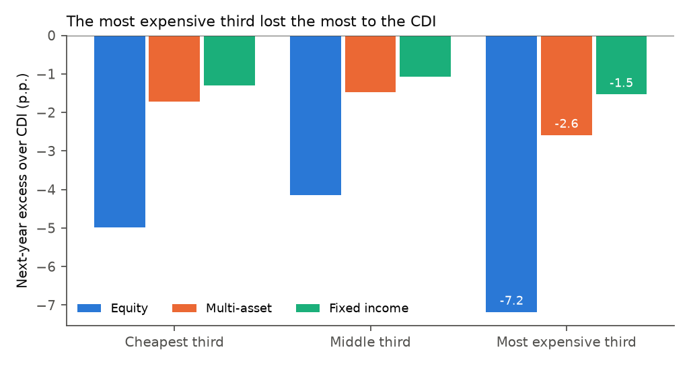

# Applied econometrics

Four short empirical studies on Brazilian and US data, each rebuilt end to end by code: the data is downloaded,
checked, modelled, and every number in the write-up is checked against the tables by an AI reviewer.




## The four studies

Each one runs on its own; the command rebuilds its tables and its PDF report.

| Study | Command | Report |
|---|---|---|
| [01 · Is there a Phillips-curve trade-off in Brazil? (2012-2026)](papers/01-phillips-curve/) | `python run_all.py 01` | [PDF](final-reports/01-phillips-curve.pdf) |
| [02 · Crime and deterrence: a county panel (US)](papers/02-crime-panel/) | `python run_all.py 02` | [PDF](final-reports/02-crime-panel.pdf) |
| [03 · Evangelical density and recorded domestic violence in Brazilian municipalities](papers/03-religion-and-domestic-violence/) | `python run_all.py 03` | [PDF](final-reports/03-religion-and-domestic-violence.pdf) |
| [04 · Picking Brazilian retail funds: does past performance help, and what do fees cost?](papers/04-fund-selection/) | `python run_all.py 04` | [PDF](final-reports/04-fund-selection.pdf) |

Studies 01-03 come from my part of coursework for a UFRJ econometrics course. Study 04 is new, built for this portfolio:
it compares Brazilian retail funds using public CVM data.

## What it shows

- Data problems are caught before any model runs: a check stopped a silent merge error that had dropped São Paulo,
  Rio de Janeiro and Brasília from one study.
- The tables graded in the course come out identical every time the code runs.
- An AI reviewer checks each number and each coefficient reading in the write-ups against the tables.

## Run it

```bash
pip install -r requirements.txt
python run_all.py
```

Runs without an API key, replaying recorded answers. Set `ANTHROPIC_API_KEY` to call Claude live.

## More

- [How I use it](docs/how-it-works.md#how-i-use-it): how I worked on these studies and how I use them now.
- [How it works](docs/how-it-works.md): the pipeline, the data, the results in numbers, origin and role.
- [RUNBOOK.md](RUNBOOK.md): updating the data and what to do when something fails.

## Limits

- All four studies are associational; none claims a causal effect.
- Study 04 covers 2021-2025 only.
- The reviewer checks the write-up against the tables, not whether a model is the right one.

## How AI was used

I use Claude (Claude Code and the API) for coding, review and documentation. The questions, modelling choices,
validation and conclusions are mine.

## License

MIT. See [LICENSE](LICENSE).
